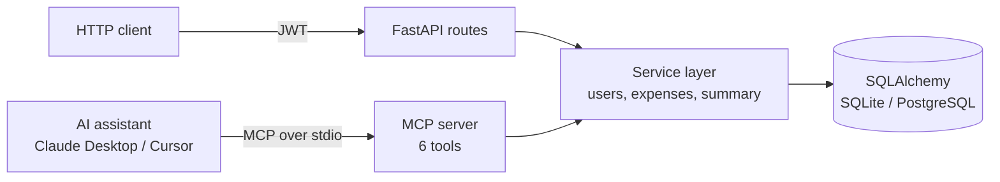

# Expense Tracker — REST API + MCP Server

A personal expense tracker with two interfaces over the same core:

- a **FastAPI REST API** with user registration, JWT authentication and per-user expense CRUD, and
- an **MCP (Model Context Protocol) server** that lets AI assistants such as Claude Desktop or Cursor add, list, update and summarise your expenses through natural language.

Both share one service layer and database, so an expense added by the AI shows up in the API and vice versa.

---

## Architecture



The service layer raises domain errors (`NotFoundError`, `PermissionDeniedError`, `ConflictError`, `AuthenticationError`); the API maps them to 404 / 403 / 409 / 401 and the MCP server returns them as tool errors, so neither interface duplicates business rules.

## Features

- Registration and login with **PBKDF2-SHA256** password hashing (600,000 iterations, per-user salt)
- **JWT (HS256) implemented from scratch** with HMAC signing, constant-time signature comparison and expiry checks
- Expense CRUD scoped to the logged-in user — other users' expenses return 403
- Spending summary (count and total)
- Input validation with Pydantic (non-empty title, amount > 0); password hashes are never returned
- Works with SQLite out of the box; with PostgreSQL the database is created automatically if missing

## Tech stack

Python · FastAPI · SQLAlchemy · Pydantic · Model Context Protocol (MCP Python SDK) · SQLite / PostgreSQL

## REST API

| Method | Endpoint | Auth | Description |
|---|---|---|---|
| POST | `/register` | — | Create an account (`name`, `email`, `password`) |
| POST | `/login?email=…&password=…` | — | Get a bearer token |
| POST | `/expenses` | ✓ | Add an expense (`title`, `amount`) |
| GET | `/expenses` | ✓ | List your expenses, newest first |
| GET | `/expenses/summary` | ✓ | Count and total |
| GET | `/expenses/{id}` | ✓ | Get one expense |
| PUT | `/expenses/{id}` | ✓ | Update title and amount |
| DELETE | `/expenses/{id}` | ✓ | Delete an expense |
| GET | `/health` | — | Database health check |

Send the token as `Authorization: Bearer <token>`. Interactive docs: `http://localhost:8000/docs`.

## MCP tools

| Tool | What it does |
|---|---|
| `add_expense(title, amount)` | Record a new expense |
| `list_expenses()` | List all expenses |
| `get_expense(expense_id)` | Get one expense |
| `update_expense(expense_id, title, amount)` | Edit an expense |
| `delete_expense(expense_id)` | Delete an expense |
| `expense_summary()` | Number of expenses and total spent |

Example prompts once connected: *"Add ₹450 for dinner"*, *"How much have I spent so far?"*, *"Delete the cab expense."*

## Run locally

```bash
python -m venv venv
source venv/bin/activate        # Windows: venv\Scripts\activate
pip install -r requirements.txt
cp .env.example .env
```

**REST API**

```bash
uvicorn main:app --reload
```

Register a user at `/docs` (or with `POST /register`), then put the same email and password in `.env` as `EXPENSE_USER_EMAIL` / `EXPENSE_USER_PASSWORD` for the MCP server.

**MCP server** — add it to your MCP client's config, e.g. Claude Desktop's `claude_desktop_config.json`:

```json
{
  "mcpServers": {
    "expense-tracker": {
      "command": "/absolute/path/to/venv/bin/python",
      "args": ["/absolute/path/to/Expense_Tracker_MCP/mcp_server.py"],
      "env": {
        "DATABASE_URL": "sqlite:////absolute/path/to/Expense_Tracker_MCP/expenses.db",
        "EXPENSE_USER_EMAIL": "you@example.com",
        "EXPENSE_USER_PASSWORD": "your_password"
      }
    }
  }
}
```

Use absolute paths so the API and the MCP server point at the same database.

## Project structure

```
├── main.py               FastAPI app
├── mcp_server.py         MCP server exposing expense tools
└── app/
    ├── core/config.py    settings from environment
    ├── db/session.py     engine, sessions, table creation
    ├── models/           User and Expense ORM models
    ├── schemas/          Pydantic request / response models
    ├── auth/             password hashing, JWT, current-user dependency
    ├── services/         business logic and domain errors
    └── routes/           auth, expense and health endpoints
```
